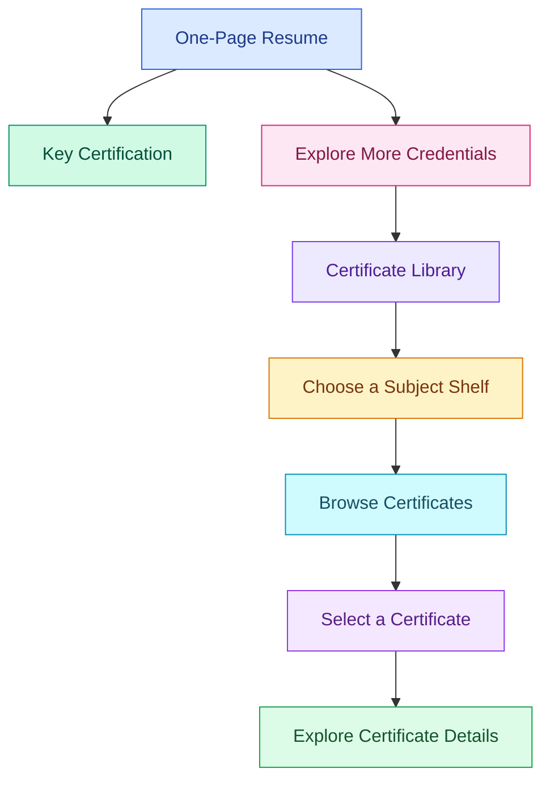

<h1 align="center">Somapuram Uday | Certificate Library</h1>

<p align="center">
  <strong>The resume is one page. The credentials don't stop there.</strong>
</p>

<p align="center">
  <a href="https://udaycodespace.github.io/certifications/">
    
  </a>
  
  
</p>

<p align="center">
  
  
  
  
  
</p>

## Why a certificate library?

My resume highlights my experience, projects, technical skills, education, and one key certification. Listing every credential related to my learning and professional development would extend it beyond one page.

Instead, this library documents my other certifications in one place while keeping my resume concise. Each credential is organized into a subject-based shelf, making it easier to find certifications relevant to a particular skill area or use case.

**Looking for a specific area?** Choose a shelf, explore the certificates, and follow the available links to view the original credentials.

## Explore the shelves

<table align="center">
  <thead>
    <tr>
      <th align="center">Subject</th>
      <th align="center">What you'll find</th>
      <th align="center">Count</th>
    </tr>
  </thead>
  <tbody>
    <tr>
      <td align="center">Data &amp; Microsoft Fabric</td>
      <td align="center">Data engineering and Microsoft Fabric</td>
      <td align="center">1</td>
    </tr>
    <tr>
      <td align="center">AI &amp; Machine Learning</td>
      <td align="center">AI fundamentals, machine learning, and related training</td>
      <td align="center">4</td>
    </tr>
    <tr>
      <td align="center">Working with Data</td>
      <td align="center">Data analytics, statistics, and Excel</td>
      <td align="center">4</td>
    </tr>
    <tr>
      <td align="center">Coding &amp; Development</td>
      <td align="center">Python, Java, Android, and IoT</td>
      <td align="center">6</td>
    </tr>
    <tr>
      <td align="center">Problem Solving</td>
      <td align="center">Competitive programming and graph concepts</td>
      <td align="center">2</td>
    </tr>
    <tr>
      <td align="center">Communication</td>
      <td align="center">Presentations and Business English</td>
      <td align="center">2</td>
    </tr>
    <tr>
      <td align="center"><strong>Total</strong></td>
      <td align="center"><strong>Six subject areas</strong></td>
      <td align="center"><strong>19</strong></td>
    </tr>
  </tbody>
</table>

## From resume to credential

The resume provides a concise overview of my qualifications. The library lets you explore my certifications in greater detail, organized by subject so you can find the areas most relevant to you.



## Inside the library

Each certificate appears as a book on its corresponding shelf. Select a cover to explore the credential's details, including its title, issuing organization, completion date, and course information. Where a credential link is available, you can open the original certificate or verification page.

The interface uses category-based colors and book-cover designs to distinguish subjects. Animations add interaction to browsing and selecting certificates, while the site respects the browser's reduced-motion preference.

## Technology stack

<table align="center">
  <thead>
    <tr>
      <th align="center">Technology</th>
      <th align="center">Purpose</th>
    </tr>
  </thead>
  <tbody>
    <tr>
      <td align="center"></td>
      <td align="center">Page structure and content</td>
    </tr>
    <tr>
      <td align="center"></td>
      <td align="center">Layout, typography, and book-cover styling</td>
    </tr>
    <tr>
      <td align="center"></td>
      <td align="center">Certificate data, shelf generation, and interactions</td>
    </tr>
    <tr>
      <td align="center"><a href="https://animejs.com/">Anime.js</a></td>
      <td align="center">Animations and book interactions</td>
    </tr>
    <tr>
      <td align="center"><a href="https://lenis.darkroom.engineering/">Lenis</a></td>
      <td align="center">Smooth scrolling</td>
    </tr>
    <tr>
      <td align="center"><a href="https://fonts.google.com/">Google Fonts</a></td>
      <td align="center">Young Serif, Instrument Sans, and Fragment Mono</td>
    </tr>
  </tbody>
</table>

## Project structure

```text
credentials/
├── index.html
├── style.css
├── script.js
└── README.md
```

Certificate records are maintained in the `items` array in `script.js`. Each entry defines its category, title, issuing organization, completion date, description, and optional credential URL.

## What's next?

The library is designed to grow as I continue learning and earning certifications. Future improvements include adding direct **View Credential** links wherever original certificates or verification pages are available, introducing search and filtering by subject or issuer, and expanding the collection with new credentials.

The goal is to make the collection more than a list of completed courses. It should help visitors quickly find the qualifications relevant to their interests and explore the underlying credentials when they want more detail.

---

<p align="center">
  <strong>Less space on the resume. More room to explore.</strong>
</p>

<p align="center">
  <a href="https://udaycodespace.github.io/credentials/">
    
  </a>
</p>

<p align="center">
  <sub>Built and maintained by Somapuram Uday.</sub>
</p>
